# Privacy-first crypto storefront

A complete online store that takes payment in Bitcoin, ETH, USDC and Monero, built for a client
who wanted to sell without collecting more customer data than an order needs, and without a
payment company in the middle. It runs in production on the client's own server.

I designed, built, deployed and secured it end to end in about four weeks: the shop, the admin,
the payment integration, the privacy engine, the server, the deployment pipeline and the
security testing.

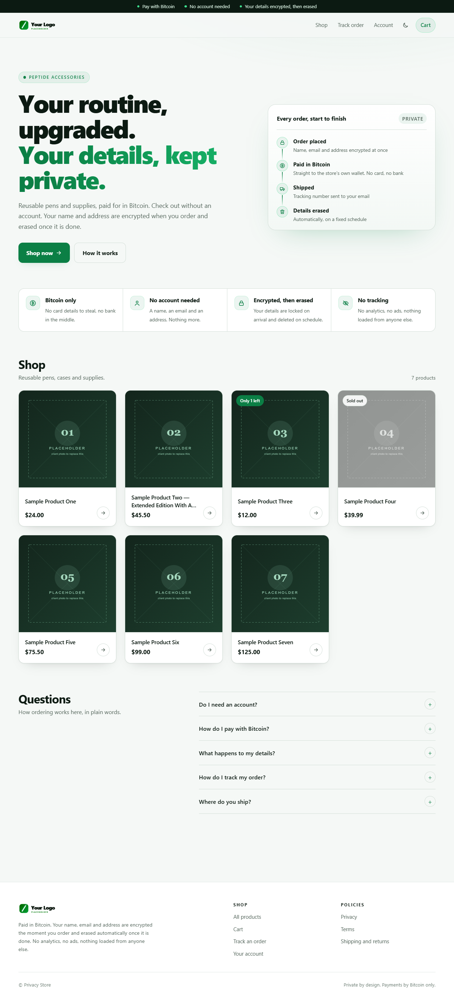

## What it does

**For customers**
- Catalog and product pages with photo galleries, light and dark mode, and full phone support
- Bulk prices per product ("10 or more at $20 each"), discounts by order total, discount codes
  and free shipping over a threshold, with the cart showing how much more unlocks the next discount
- Guest checkout that asks only for a name, an email and a delivery address; optional accounts
  with order history and self-service account deletion
- Payment in Bitcoin, Monero, or ETH/USDC and other coins (swapped to Bitcoin on the payment page)
- Order tracking by order number and email, and order emails at each step, every one showing how
  the total was reached

**For the owner**
- Admin for products, photos (location data stripped on upload), stock, bulk prices, discounts,
  shipping, the store logo and policy pages
- Orders from payment to delivery: tracking numbers, refunds, under- and over-payments, resending
  emails, private staff notes
- An encrypted export of all records that only the owner's own key can open

## How it protects customers

- **Encrypted at rest:** names, emails and addresses are encrypted with AES-256-GCM, each bound to
  its column; emails are looked up through an HMAC blind index, never in plain text
- **Deleted on schedule:** a nightly job erases customer details a set number of days after an
  order is finished, keeping only anonymous sales totals
- **Nothing third-party:** no analytics, no ads, no external scripts or fonts; a strict
  Content-Security-Policy enforces it, and order emails carry no tracking
- **Backups the server cannot read:** nightly database backups are encrypted with `age` to the
  owner's public key; the private key never touches the server
- **Every address view is logged,** so the owner always knows who has seen a customer's details

## Payments

Self-hosted [BTCPay Server](https://btcpayserver.org) with its own Bitcoin node (pruned), a
Monero node and view-only wallet, and the Trocador plugin for ETH, USDC and other coins. Money goes
straight to the owner's wallets; the store never holds funds or keys that can spend them.

The store talks to BTCPay over its Greenfield API and reacts to signed webhooks:
- every webhook is HMAC-verified over the raw body before anything is read
- each delivery is stored once by id, so retries and replays are harmless
- one state machine, run in a single transaction with the order row locked, handles paid,
  expired, under-paid, over-paid and invalid invoices, including events that arrive late or out
  of order
- a reconciliation job catches any webhook that never arrived

## Security

- OWASP Top 10 review with each control backed by an automated test; OWASP ZAP scans of the live
  site (0 failures) and of the signed-in admin (0 high, 0 medium, 0 low); every finding fixed
- Argon2id passwords, account lockout, per-address rate limits, CSRF protection, session ids
  stored only as hashes
- `npm audit` on every push; a weekly Trivy scan of the production image and a signed-in ZAP
  scan of the admin
- Hardened server: SSH by key only, a firewall that only accepts traffic from Cloudflare, fail2ban,
  nightly security updates; Cloudflare WAF with rate limits and a human check on checkout
- No dependency runs code at install time (`ignore-scripts=true`)

## Stack

| Layer | Choice |
|---|---|
| Server | Node.js 22, TypeScript, Fastify 5 |
| Views | Nunjucks, server-rendered, no client-side JavaScript |
| Data | PostgreSQL 16, Kysely, numbered and checksummed SQL migrations |
| Validation | Zod |
| Payments | BTCPay Server (Bitcoin, Lightning-ready), Monero plugin, Trocador |
| Email | SMTP (Brevo in production), with an outbox and retries |
| Delivery | Docker Compose, Caddy, Cloudflare, GitHub Actions |

## Engineering

- **254 automated tests** covering checkout, payments, webhooks, privacy deletion, encryption,
  access control and the admin
- **CI/CD:** every push is tested, built into a production image, smoke-tested and deployed; a
  failed deploy rolls back automatically
- **Restore drill:** a script restores an encrypted backup into a scratch database to prove
  backups work

## Screenshots

| | |
|---|---|
| 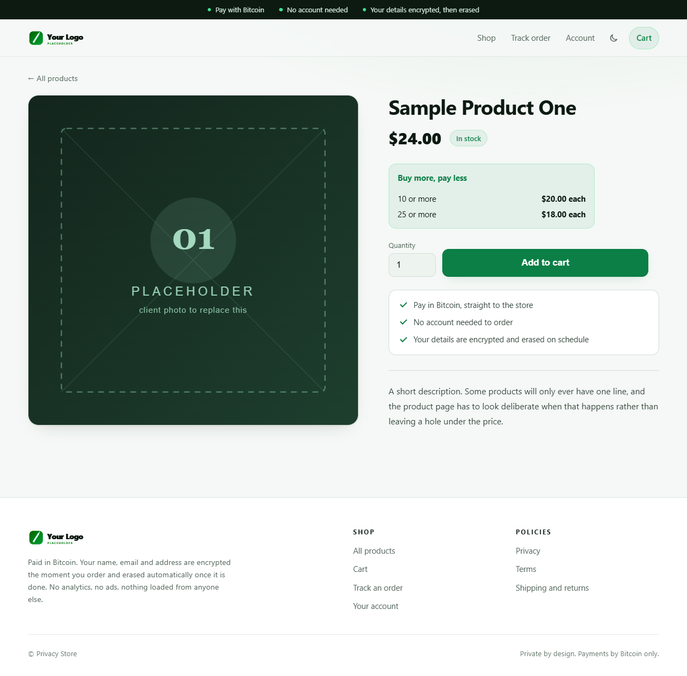 | 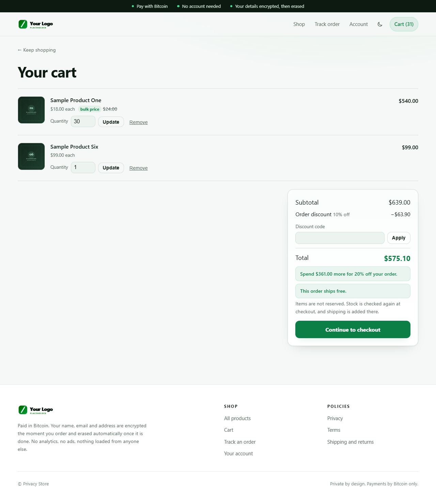 |
| Product page with bulk prices | Cart: bulk price, order discount, free shipping |
| 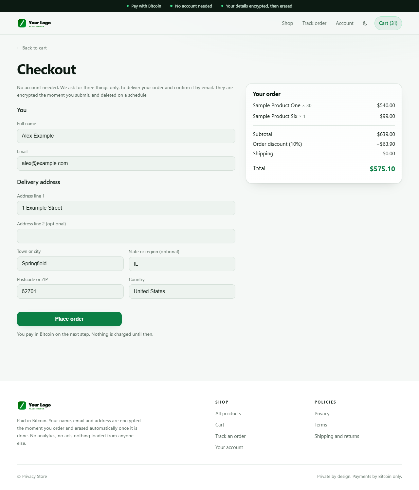 | 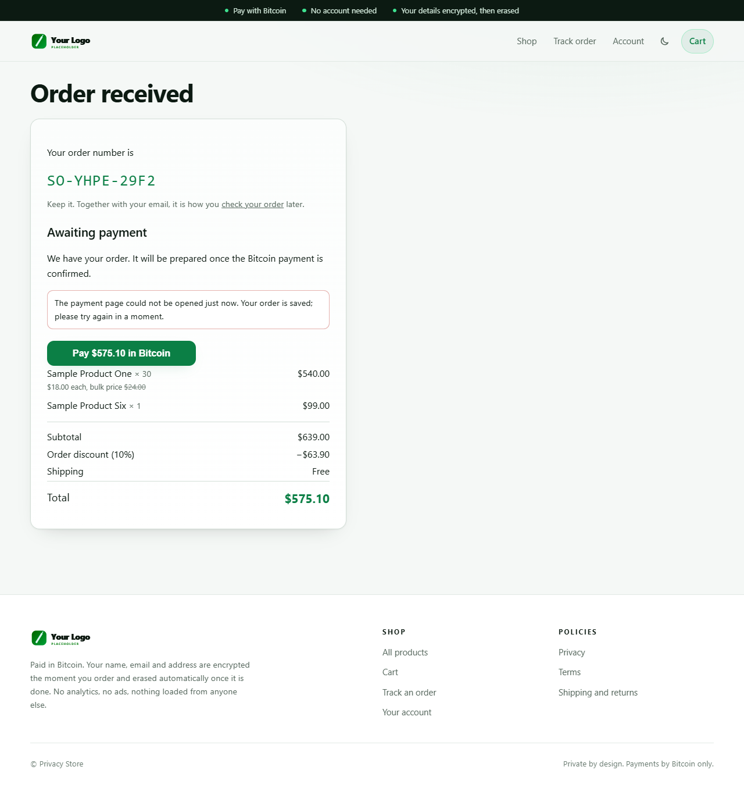 |
| Checkout: name, email and address only | Order confirmation with the full breakdown |
| 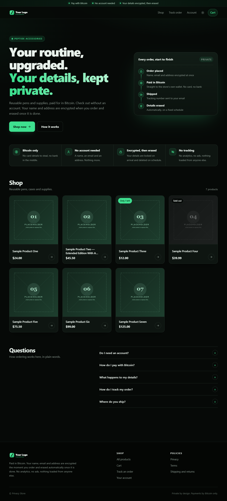 | 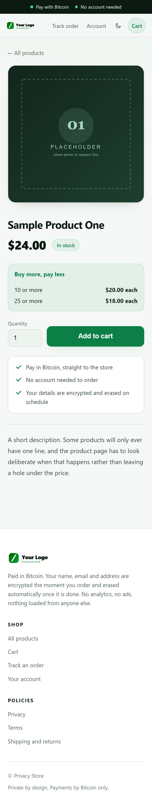 |
| Dark mode | Phone |
| 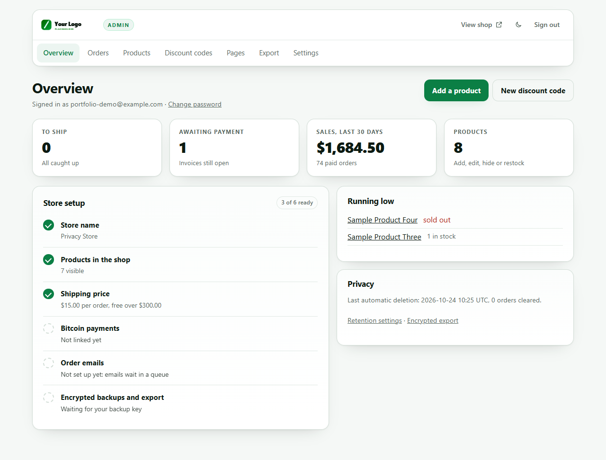 | 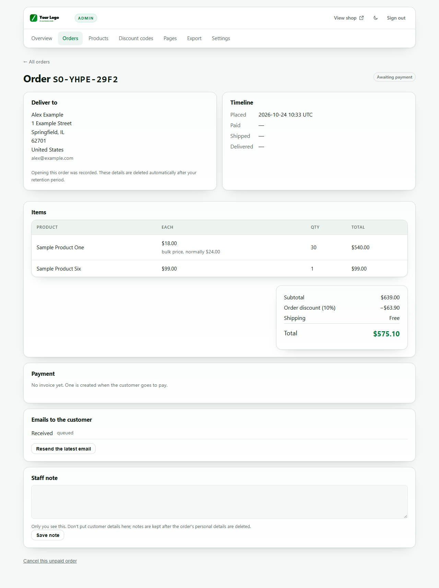 |
| Admin overview | An order, from payment to delivery |
| 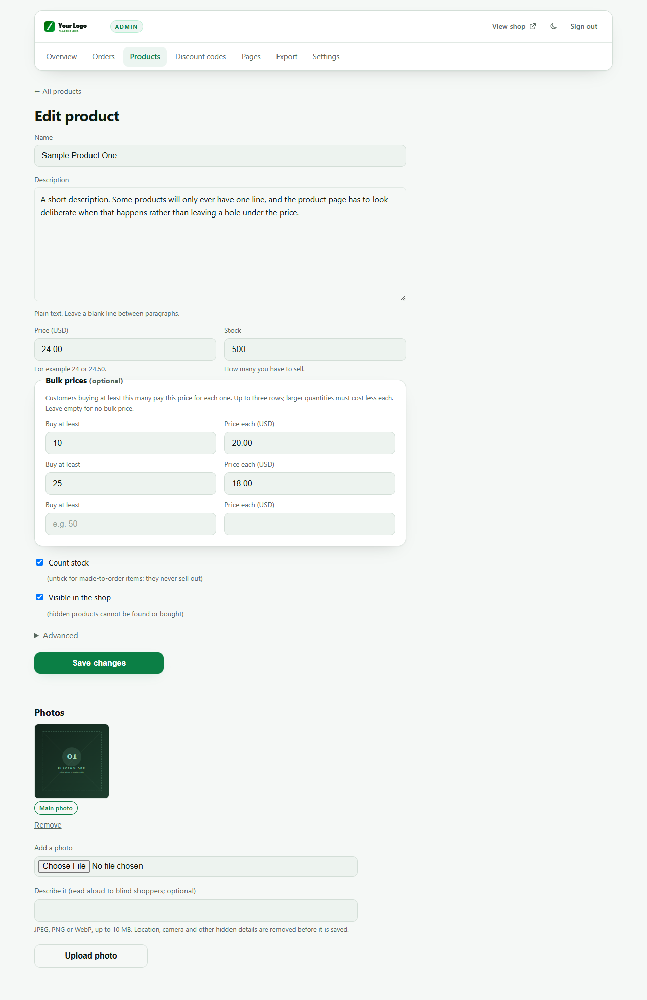 | 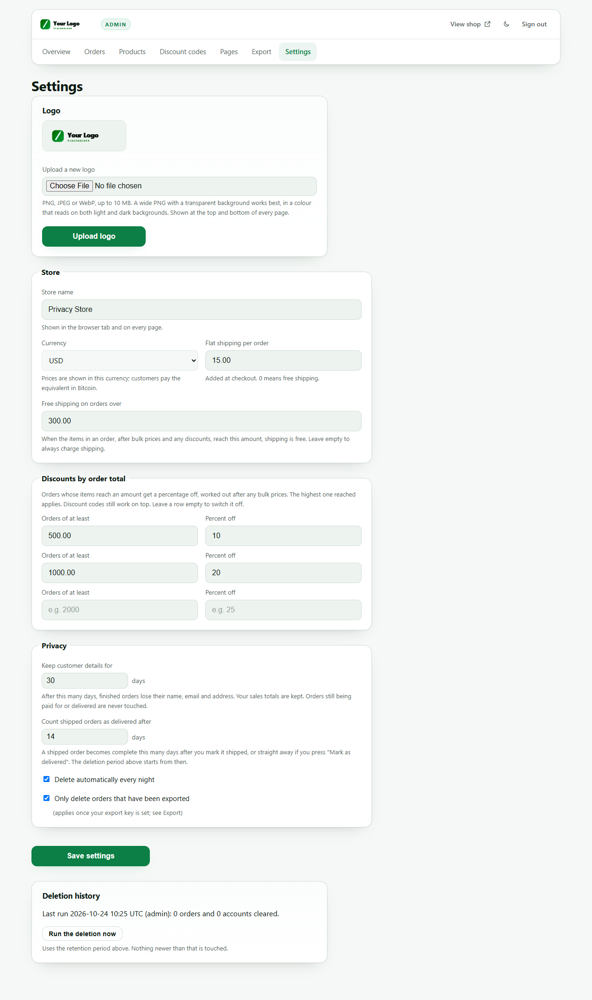 |
| Product editor with bulk prices | Settings: shipping, discounts, retention, logo |

All screenshots show the store running locally with placeholder products and made-up orders. The
confirmation page notes that the payment page could not be opened because no payment server was
connected for the screenshots.

## Running it locally

```
npm ci                       # install scripts stay off
cp .env.example .env         # set DATABASE_URL and three random keys
npm run migrate
npm run seed                 # 8 placeholder products
npm test
npm run dev                  # http://localhost:3000
npm run admin:create -- you@example.com
```

`docs/RUNBOOK.md` covers deployment, rollback, backups and key rotation.
